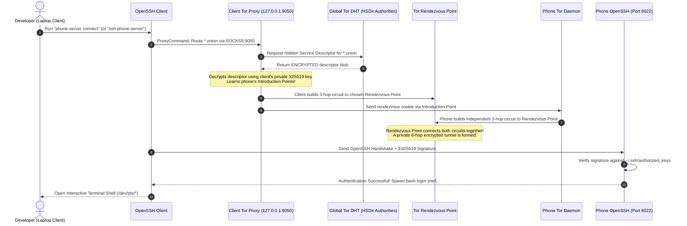

# 🛠️ Stealth Tor v3 Phone Server — Comprehensive Developer & Architecture Guide

Welcome to the **Stealth Tor v3 Phone Server Developer Guide**.

This guide is written for **everyone**—from curious beginners setting up their first Linux project to systems engineers auditing low-level security and kernel mechanics. It explains:
1. **The Big Picture & Layman Mental Models** (what this system does in simple English).
2. **Client vs. Server Mechanics** (what code runs where, why, and how packets travel).
3. **The Complete Toolchain: Where Every Tool Is Actually Used** (exact files, line numbers, code snippets, and rationale).
4. **15 Formal Engineering Decision Records (EDRs)** (every technical decision justified against alternatives).
5. **The Real-World Production War Stories** (the exact bugs we faced, our root cause analyses, and permanent fixes).
6. **Future Flexibility & Extensibility** (multi-client scaling, hosting APIs, databases, and Git).
7. **Developer Diagnostics & Troubleshooting Toolkit** (commands to inspect every socket, process, and circuit).

---

## 📑 Table of Contents

1. [The Big Picture (Explain Like I'm 5)](#1-the-big-picture-explain-like-im-5)
   - [What is this project?](#what-is-this-project)
   - [The VIP Vault Analogy](#the-vip-vault-analogy)
2. [Client vs. Server: What Runs Where?](#2-client-vs-server-what-runs-where)
   - [Side-by-Side Architectural Matrix](#side-by-side-architectural-matrix)
   - [What Happens on the Client Device?](#what-happens-on-the-client-device)
   - [What Happens on the Phone Server?](#what-happens-on-the-phone-server)
   - [The End-to-End Cryptographic Sequence Flow](#the-end-to-end-cryptographic-sequence-flow)
3. [The Complete Toolchain: Where Every Tool Is Actually Used](#3-the-complete-toolchain-where-every-tool-is-actually-used)
   - [Toolchain Location & Code Snippet Matrix](#toolchain-location--code-snippet-matrix)
   - [Deep Dive into Each Tool's Exact Implementation](#deep-dive-into-each-tools-exact-implementation)
4. [Formal Engineering Decision Records (EDRs)](#4-formal-engineering-decision-records-edrs)
   - [EDR-01: Tor v3 Onion Routing vs. SaaS Relays (Tailscale, Cloudflare, Ngrok)](#edr-01-tor-v3-onion-routing-vs-saas-relays)
   - [EDR-02: Tor v3 Stealth Mode (X25519) vs. Public Hidden Services](#edr-02-tor-v3-stealth-mode-x25519-vs-public-hidden-services)
   - [EDR-03: OpenSSH 9.8+ with Ed25519 vs. RSA / Passwords](#edr-03-openssh-98-with-ed25519-vs-rsa--passwords)
   - [EDR-04: Native Termux Userspace vs. PRoot / Chroot / Linux Deploy / Custom APK](#edr-04-native-termux-userspace-vs-proot--chroot--linux-deploy--custom-apk)
   - [EDR-05: GNU `coreutils base32` vs. Android Toybox `base32`](#edr-05-gnu-coreutils-base32-vs-android-toybox-base32)
   - [EDR-06: `openssl-tool` Package vs. `openssl`](#edr-06-openssl-tool-package-vs-openssl)
   - [EDR-07: `netcat-openbsd` ProxyCommand vs. `socat` / `connect-proxy`](#edr-07-netcat-openbsd-proxycommand-vs-socat--connect-proxy)
   - [EDR-08: Process Supervision via `pidof` + Native Bash `/dev/tcp/` vs. Toybox `pgrep`](#edr-08-process-supervision-via-pidof--native-bash-devtcp-vs-toybox-pgrep)
   - [EDR-09: Background Watchdog with Tor `SIGHUP` vs. Polling / Port Rebind / Systemd / Cron](#edr-09-background-watchdog-with-tor-sighup-vs-polling--port-rebind--systemd--cron)
   - [EDR-10: Tor State File Preservation vs. Aggressive State Wiping (Guards & Anonymity Stability)](#edr-10-tor-state-file-preservation-vs-aggressive-state-wiping-guards--anonymity-stability)
   - [EDR-11: OpenSSH Connection Multiplexing (`ControlMaster`) vs. Raw Cold Tor Circuits](#edr-11-openssh-connection-multiplexing-controlmaster-vs-raw-cold-tor-circuits)
   - [EDR-12: Context-Aware Remote Cycling (`[ -n "$SSH_CONNECTION" ]`) vs. Monolithic Process Kill](#edr-12-context-aware-remote-cycling-vs-monolithic-process-kill)
   - [EDR-13: PTY-Filtered Session Counting (`/dev/pts/`) vs. TCP Socket Counting](#edr-13-pty-filtered-session-counting-devpts-vs-tcp-socket-counting)
   - [EDR-14: 100% Non-Root Android Compatibility vs. Magisk Root Enforcement](#edr-14-100-non-root-android-compatibility-vs-magisk-root-enforcement)
   - [EDR-15: Mobile Carrier NAT Keepalive Tuning (`KeepalivePeriod 30`, `ConnectionPadding 1`)](#edr-15-mobile-carrier-nat-keepalive-tuning)
5. [The Real-World Production War Stories](#5-the-real-world-production-war-stories)
   - [War Story 1: The Dynamic IP / Wi-Fi Roaming Black Hole](#war-story-1-the-dynamic-ip--wi-fi-roaming-black-hole)
   - [War Story 2: The Tor Descriptor Upload Rate-Limit Lockout (`state` file)](#war-story-2-the-tor-descriptor-upload-rate-limit-lockout-state-file)
   - [War Story 3: The Android Toybox `pgrep` Trap](#war-story-3-the-android-toybox-pgrep-trap)
   - [War Story 4: The Remote SSH Session Suicide](#war-story-4-the-remote-ssh-session-suicide)
   - [War Story 5: The 30–45s Global DHT Propagation Delay](#war-story-5-the-3045s-global-dht-propagation-delay)
6. [Future Flexibility & Extensibility](#6-future-flexibility--extensibility)
   - [Adding Multiple Devices Seamlessly](#adding-multiple-devices-seamlessly)
   - [Client Key Revocation & Compromise Recovery](#client-key-revocation--compromise-recovery)
   - [Host-Key Pinning & Trust on First Use (TOFU)](#host-key-pinning--trust-on-first-use-tofu)
   - [Backup & Disaster Recovery Procedure](#backup--disaster-recovery-procedure)
   - [Mobile NAT Keepalive & Traffic Tuning](#mobile-nat-keepalive--traffic-tuning)
   - [Hosting Any Service (Web Servers, APIs, Databases, Git)](#hosting-any-service-web-servers-apis-databases-git)
   - [Global Network Agnosticism](#global-network-agnosticism)
7. [Codebase Architecture & File-by-File Analysis](#7-codebase-architecture--file-by-file-analysis)
   - [`phone-server` (Unified CLI & TUI Dashboard)](#phone-server-unified-cli--tui-dashboard)
   - [`setup-server-termux.sh` (Server Engine)](#setup-server-termuxsh-server-engine)
   - [`setup-client-linux.sh` (Linux Client Engine)](#setup-client-linuxsh-linux-client-engine)
   - [`setup-client-termux.sh` (Mobile Client Engine)](#setup-client-termuxsh-mobile-client-engine)
8. [Developer Diagnostics & Troubleshooting Toolkit](#8-developer-diagnostics--troubleshooting-toolkit)

---

## 1. The Big Picture (Explain Like I'm 5)

### What is this project?
Imagine you have an Android phone lying around that you want to turn into a miniature personal server. Normally, controlling a server over the internet requires:
1. Opening ports on your home Wi-Fi router (which invites hackers and port scanners to attack your home network).
2. Buying a public domain name and setting up Dynamic DNS (DDNS).
3. Or signing up for third-party cloud tools like Tailscale, Cloudflare Tunnels, or Ngrok that require creating accounts, surrendering your email, and routing your traffic through proprietary servers.

Worse, **if your phone is on mobile data (4G/5G), your phone does not even have a public IP address**. Mobile carriers place all phones behind Carrier-Grade NAT (CGNAT), which blocks all incoming connections from the outside world.

**Stealth Tor v3 Phone Server completely eliminates all of these hurdles.** It turns your Android phone into an invisible, 24/7 personal Linux server that only **you** can access from your laptop or another phone—without accounts, without open router ports, without public IPs, and without needing root access.

---

### The VIP Vault Analogy

To visualize how our security works, picture a secret underground VIP vault:

```text
+-------------------------------------------------------------------------------+
|                               THE VIP VAULT ANALOGY                           |
|                                                                               |
|   1. The Invisible Safe (Server Phone):                                       |
|      - Buried underground with NO doors, windows, or signs on the street.     |
|      - Posts an encrypted note in a public locker (Tor DHT) that can          |
|        ONLY be deciphered if you have a special cryptographic lens.           |
|                                                                               |
|   2. The Client (Laptop / Second Phone):                                      |
|      - Gate 1: You use your Lens (X25519 Tor Private Key) to read the secret  |
|        note and find where the secret tunnel meets (Rendezvous Point).        |
|        * Anyone without this lens cannot even see that the vault exists!      |
|      - Gate 2: Once inside the tunnel, you insert your Physical Keycard       |
|        (Ed25519 SSH Key) to unlock the command terminal.                      |
+-------------------------------------------------------------------------------+
```

If a hacker, botnet, or network snooper scans your phone's onion address without your **Gate 1** key, Tor immediately replies `Host unreachable`. Zero network packets ever reach your phone!

---

## 2. Client vs. Server: What Runs Where?

A fundamental concept in distributed systems is understanding which device performs which job.

### Side-by-Side Architectural Matrix

| Feature / Responsibility | Client Device (Laptop or 2nd Phone) | Server Device (Primary Android Phone) |
| :--- | :--- | :--- |
| **Operating System** | Standard Linux (Ubuntu/Fedora/Arch) or Termux | Android Termux (100% Non-Root Userspace) |
| **Primary Daemons** | Local Tor SOCKS5 proxy (`127.0.0.1:9050`) | Tor Onion Daemon + OpenSSH (`sshd:8022`) |
| **Supervisor Daemon** | None needed (CLI tools run on-demand) | `watchdog-server` (monitors IP churn every 8s) |
| **Gate 1 (Stealth Tor)** | Holds **Private Key** (`~/.tor_keys/x25519_priv.pem`) | Holds **Public Lock** (`authorized_clients/*.auth`) |
| **Gate 2 (SSH Terminal)**| Holds **Private SSH Key** (`~/.ssh/phone_server_ed25519`)| Holds **Authorized Public Key** (`~/.ssh/authorized_keys`)|
| **Network Traffic Handling** | SOCKS5 proxy routes **only** `*.onion` traffic | Accepts incoming 6-hop rendezvous tunnel |
| **Connection Performance** | Multiplexed socket (`ControlMaster`, `<0.1s` tabs) | Fast local loopback forwarding (`127.0.0.1:8022`) |
| **Power Management** | Standard OS sleep settings | `termux-wake-lock` + Android Doze exemption |

---

### What Happens on the Client Device?

Your client device (laptop or secondary phone) is your **control station**:
1. **Key Generation**: Generates an Ed25519 SSH keypair and an X25519 Tor client authorization keypair.
2. **Local Tor Proxy (`127.0.0.1:9050`)**: Runs a lightweight local Tor client. It is configured with `ClientOnionAuthDir`, which maps your private X25519 key to your server's `.onion` address.
3. **Isolated SOCKS5 Routing**: You don't route your whole computer through Tor. Only traffic destined for `phone-server` is routed through the proxy via OpenSSH's `ProxyCommand`. All other web browsing runs at full ISP speed.
4. **SSH Connection Multiplexing (`ControlMaster`)**: The first SSH connection takes 3–5 seconds to build the 6-hop Tor tunnel. Once built, SSH keeps a local UNIX domain socket open (`~/.ssh/control-*`). Any new terminal tab or command you run reuses the open tunnel in **under 100 milliseconds**!

---

### What Happens on the Phone Server?

Your phone server is a dedicated headless node:
1. **Zero Inbound Ports**: The phone never listens for incoming connections from the outside internet. Instead, it connects **outward** to Tor relays called Introduction Points. This allows it to work behind 4G/5G Carrier-Grade NAT and strict Wi-Fi firewalls.
2. **Encrypted Descriptor Publication**: Tor publishes its hidden service descriptor to the Tor Distributed Hash Table (HSDir). But because client authorization is enabled, the descriptor is encrypted with your client's X25519 public key. To everyone else on the internet, the descriptor is indecipherable random noise.
3. **OpenSSH Server (`sshd:8022`)**: Listens strictly on loopback port 8022. Password authentication is disabled; only your authorized Ed25519 public key can open a shell.
4. **Dynamic IP Auto-Healing Watchdog (`watchdog-server`)**: A background loop inspects network interfaces every 8 seconds. If your phone switches from home Wi-Fi to cellular data, it immediately issues a `SIGHUP` to Tor, seamlessly rebuilding circuits on the new interface in 10–15 seconds.
5. **Wakelock Protection**: Runs `termux-wake-lock` to keep the Android CPU alive even when the screen is turned off and the device is unplugged.

---

### The End-to-End Cryptographic Sequence Flow



---

## 3. The Complete Toolchain: Where Every Tool Is Actually Used

Every single utility in this project was deliberately chosen for a specific engineering requirement. Below is the exhaustive reference showing **where every tool is used in the codebase**, the exact code snippet, and its technical rationale.

### Toolchain Location & Code Snippet Matrix

| Tool / Binary | Where Used (File & Function) | Exact Code Snippet / Invocation | Engineering Rationale |
| :--- | :--- | :--- | :--- |
| **`tor`** (Daemon) | • `setup-server-termux.sh` (`start-server`)<br>• `phone-server` (`ensure_local_tor_active`)<br>• `setup-client-termux.sh` | `nohup $PREFIX/bin/tor > "$PREFIX/var/lib/tor/tor.log" 2>&1 &` | Runs the v3 onion hidden service on server and local SOCKS5 proxy on client. |
| **`sshd`** (OpenSSH) | • `setup-server-termux.sh` (`start-server`, `watchdog-server`) | `$PREFIX/bin/sshd`<br>`pidof sshd` | Master SSH listener on port 8022. Spawns session workers on incoming connections. |
| **`sshd-session`** | • `setup-server-termux.sh` (`stop-server`, `status-server`) | `su -c "pgrep sshd-session"`<br>`killall -9 sshd-session 2>/dev/null` | OpenSSH 9.8+ privilege-separated worker processes. Inspected to count active terminal sessions. |
| **`ssh-keygen`** | • `setup-client-linux.sh` (Step 2)<br>• `setup-client-termux.sh` (Step 2)<br>• `setup-server-termux.sh` (`start-server`) | `ssh-keygen -t ed25519 -f "$SSH_KEY_FILE" -N ""` | Generates Ed25519 SSH client keys and ensures server host keys exist (`ssh-keygen -A`). |
| **`openssl`** (`openssl-tool`) | • `setup-client-linux.sh` (Step 3)<br>• `setup-client-termux.sh` (Step 3) | `openssl genpkey -algorithm x25519 -out "$X25519_PEM"`<br>`openssl pkey -in ... -pubout -outform DER` | Generates Curve25519 private keys and exports raw 32-byte DER public keys for Tor authorization. |
| **GNU `base32`** (`coreutils`) | • `setup-client-linux.sh` (Step 3)<br>• `setup-client-termux.sh` (Step 3) | `... | tail -c 32 \| base32 \| tr -d '=\n\r '` | Converts raw 32-byte binary key into RFC 4648 unpadded Base32 required by Tor v3 stealth auth. |
| **`nc`** (`netcat-openbsd`) | • `setup-client-linux.sh` (Step 1 & 5)<br>• `setup-client-termux.sh` (Step 7) | `ProxyCommand nc -X 5 -x 127.0.0.1:9050 %h %p` | Establishes SOCKS5 proxy tunnel connecting OpenSSH to Tor without virtual network interfaces. |
| **`ncat`** (`nmap-ncat`) | • `setup-client-linux.sh` (Proxy detection) | `ncat --proxy-type socks5 --proxy 127.0.0.1:9050 %h %p` | Fallback SOCKS5 proxy command on Fedora, RHEL, and CentOS systems where OpenBSD netcat is unavailable. |
| **`pidof`** (`procps`) | • `setup-server-termux.sh` (`start-server`, `status-server`, `watchdog-server`) | `pidof tor >/dev/null 2>&1`<br>`pidof sshd >/dev/null 2>&1` | Android Toybox-compatible process discovery. Bypasses Toybox `pgrep` path-matching bugs. |
| **`ps`** (`procps`) | • `setup-server-termux.sh` (`status-server`) | `ps -eo ppid,tty \| grep -c -E "^ *($REGEX) +pts/"` | Filters process tree by pseudo-terminal (`pts/*`) to distinguish real interactive users from scripts. |
| **`killall`** (`psmisc`) | • `setup-server-termux.sh` (`stop-server`, `authorize-client`) | `killall -9 tor sshd sshd-session`<br>`killall -HUP tor` | Atomic signal broadcasting to immediately terminate services or reload Tor configuration descriptors. |
| **`pkill`** (`procps`) | • `setup-server-termux.sh` (`restart-server`, `watchdog-server`) | `pkill -HUP -x tor`<br>`pkill -x sshd` | Sends signals by exact process name; safely cycles listeners without terminating active SSH connections. |
| **`termux-wake-lock`** | • `setup-server-termux.sh` (`start-server`, `watchdog-server`, `start-phone-server.sh`) | `termux-wake-lock 2>/dev/null \|\| true` | Acquires userspace kernel partial wakelock (`/sys/power/wake_lock`), preventing Android CPU deep sleep. |
| **`termux-wake-unlock`** | • `setup-server-termux.sh` (`stop-server`) | `termux-wake-unlock 2>/dev/null \|\| true` | Releases partial wakelock when server is stopped to allow Android phone to sleep naturally. |
| **`Termux:Boot`** | • `setup-server-termux.sh` (Step 6g) | `$HOME/.termux/boot/start-phone-server.sh` | Android broadcast receiver integration that starts the server automatically when phone boots up. |
| **`adb`** | • Workstation terminal / dev scripts<br>• `phone-server` (`cmd_client_status --adb`) | `adb -s <id> push setup-server-termux.sh /sdcard/Download/`<br>`adb shell 'status-server'` | Provisions phones over USB, checks connected devices, pushes files, and exports client keys. |
| **`dumpsys`** | • `setup-server-termux.sh` (Root OS tuning) | `dumpsys deviceidle whitelist +com.termux` | Permanently whitelists Termux from Android Doze battery suspension. |
| **`cmd appops`** | • `setup-server-termux.sh` (Root OS tuning) | `cmd appops set com.termux RUN_IN_BACKGROUND allow`<br>`cmd appops set com.termux WAKE_LOCK allow` | Unlocks unrestricted background execution and wakelock permission in Android AppOps. |
| **`settings`** | • `setup-server-termux.sh` (Root OS tuning) | `settings put global wifi_sleep_policy 2`<br>`settings put global stay_on_while_plugged_in 3` | Configures Android Wi-Fi radio to never sleep and keeps CPU active while connected to USB/AC. |
| **`pm`** | • `setup-server-termux.sh` (Root OS tuning) | `pm disable-user --user 0 com.samsung.android.lool` | Permanently disables Samsung Device Care (`lool`), preventing aggressive background process killing. |
| **`/dev/tcp/*`** | • `phone-server`<br>• `setup-server-termux.sh`<br>• `setup-client-termux.sh` | `(echo > /dev/tcp/127.0.0.1/8022) >/dev/null 2>&1` | Native bash socket probing to test local port listening states without external binaries. |
| **`/dev/pts/*`** | • `setup-server-termux.sh` (`status-server`) | Assigned pseudo-terminals on interactive login | Terminal driver allocation inspected to ensure status checks don't count themselves as active clients. |

---

### Deep Dive into Each Tool's Exact Implementation

#### 1. OpenSSL (`openssl-tool`) & GNU Base32 (`coreutils`)
Located in [`setup-client-linux.sh`](file:///home/mayank-jain/stealth-tor-phone-server/setup-client-linux.sh#L98-L105) and [`setup-client-termux.sh`](file:///home/mayank-jain/stealth-tor-phone-server/setup-client-termux.sh#L70-L80):
```bash
# 1. Generate private key in PKCS#8 PEM format
openssl genpkey -algorithm x25519 -out "$X25519_PEM" 2>/dev/null

# 2. Extract raw 32-byte public key and private key in unpadded Base32
TOR_PUB_KEY=$(openssl pkey -in "$X25519_PEM" -pubout -outform DER | tail -c 32 | base32 | tr -d '=\n\r ')
TOR_PRIV_KEY=$(openssl pkey -in "$X25519_PEM" -outform DER | tail -c 32 | base32 | tr -d '=\n\r ')
```
- **Why this code exists**: Tor v3 client authorization requires 32-byte Curve25519 keys formatted in RFC 4648 Base32 without trailing padding (`=`). Standard OpenSSL outputs ASN.1 structures; piping through `tail -c 32 | base32 | tr -d '=\n\r '` strips the ASN.1 header and padding cleanly.

#### 2. Netcat OpenBSD (`netcat-openbsd`) & OpenSSH Multiplexing
Located in [`setup-client-linux.sh`](file:///home/mayank-jain/stealth-tor-phone-server/setup-client-linux.sh#L275-L290) and `~/.ssh/config`:
```ssh-config
Host phone-server
    HostName 3k75whkovl5mtzld42g2yjatkzdlpz3icm7j3qmxhgphtml37ckajsid.onion
    User u0_a300
    Port 8022
    IdentityFile ~/.ssh/phone_server_ed25519
    IdentitiesOnly yes
    Compression yes
    ServerAliveInterval 15
    ServerAliveCountMax 3
    ControlMaster auto
    ControlPath ~/.ssh/control-%C
    ControlPersist 10m
    ProxyCommand nc -X 5 -x 127.0.0.1:9050 %h %p
```
- **`ProxyCommand nc -X 5 -x 127.0.0.1:9050 %h %p`**: Instructs OpenSSH to use Netcat to establish a SOCKS5 tunnel through the local Tor proxy on port 9050.
- **`ControlMaster auto` & `ControlPath`**: The first connection builds the 6-hop Tor tunnel (3–5s). Once built, a persistent UNIX domain socket is created. Subsequent commands connect through this socket in **under 100ms**!

#### 3. Native Bash `/dev/tcp/` & `pidof`
Located in [`setup-server-termux.sh`](file:///home/mayank-jain/stealth-tor-phone-server/setup-server-termux.sh#L134-L148):
```bash
# Start sshd if not already listening
if (echo > /dev/tcp/127.0.0.1/8022) >/dev/null 2>&1 || pidof sshd >/dev/null 2>&1; then
    echo "[*] OpenSSH daemon is already running (port 8022)."
else
    $PREFIX/bin/sshd
    echo "[+] OpenSSH daemon started on port 8022."
fi
```
- **Why `/dev/tcp/` + `pidof`**: On Android Termux, SELinux sometimes hides processes from `ps` or Toybox `pgrep`. Probing bash's built-in `/dev/tcp/127.0.0.1/8022` directly verifies whether the TCP port is listening regardless of process table permissions.

#### 4. The 8-Second Watchdog (`watchdog-server`)
Located in [`setup-server-termux.sh`](file:///home/mayank-jain/stealth-tor-phone-server/setup-server-termux.sh#L366-L415):
```bash
get_current_ips() {
    ifconfig 2>/dev/null | grep 'inet ' | grep -v '127.0.0.1' | awk '{print $2}' | sort | tr '\n' ' '
}
LAST_IPS=$(get_current_ips)

while true; do
    sleep 8
    # 1. Ensure sshd is running
    if ! pidof sshd >/dev/null 2>&1 && ! (echo > /dev/tcp/127.0.0.1/8022) >/dev/null 2>&1; then
        $PREFIX/bin/sshd >/dev/null 2>&1 || true
    fi
    # 2. Ensure Tor is running
    if ! pidof tor >/dev/null 2>&1 && ! (echo > /dev/tcp/127.0.0.1/9050) >/dev/null 2>&1; then
        rm -f "$PREFIX/var/lib/tor/state" "$PREFIX/tmp/state" 2>/dev/null || true
        nohup $PREFIX/bin/tor > "$PREFIX/var/lib/tor/tor.log" 2>&1 &
        LAST_IPS=$(get_current_ips)
        termux-wake-lock 2>/dev/null || true
        continue
    fi
    # 3. Dynamic IP / Network Interface Change Detection
    CURRENT_IPS=$(get_current_ips)
    if [ -n "$CURRENT_IPS" ] && [ "$CURRENT_IPS" != "$LAST_IPS" ]; then
        LAST_IPS="$CURRENT_IPS"
        pkill -HUP -x tor 2>/dev/null || killall -HUP tor 2>/dev/null || true
        termux-wake-lock 2>/dev/null || true
    fi
done
```
- **Why this loop is critical**: When the phone switches from Wi-Fi to cellular data, `CURRENT_IPS` changes. Sending `SIGHUP` forces Tor to tear down dead circuits and re-establish introduction points on the new interface in seconds, without restarting the process or killing active SSH sessions.

---

## 4. Formal Engineering Decision Records (EDRs)

Every major architectural choice in this repository was evaluated against alternatives. Below are the formal engineering decisions:

---

### EDR-01: Tor v3 Onion Routing vs. SaaS Relays
* **Context**: Need remote access to an Android phone operating behind dynamic Wi-Fi and 4G/5G Carrier-Grade NAT (CGNAT).
* **Options Considered**:
  1. *Router Port Forwarding + Dynamic DNS*: Incompatible with cellular data (CGNAT blocks inbound traffic). Requires opening ports on home router.
  2. *Tailscale / ZeroTier*: Requires third-party company accounts (Google/GitHub SSO), proprietary control-plane servers, and device discovery metadata resides with a corporation.
  3. *Cloudflare Tunnels*: Requires owning a custom public domain name and trusting Cloudflare with TLS termination keys.
  4. *Ngrok*: Rate-limited, requires account verification, proxies unencrypted payloads.
  5. *Tor v3 Hidden Services*: Decentralized, zero proprietary accounts, zero open router ports, 6-hop encrypted tunnel meeting at neutral Rendezvous Points.
* **Decision**: **Tor v3 Hidden Services**. Access is anchored entirely in asymmetric cryptography. Zero reliance on centralized SaaS coordination servers.

---

### EDR-02: Tor v3 Stealth Mode (X25519) vs. Public Hidden Services
* **Context**: Standard Tor onion addresses publish unencrypted descriptors to distributed directory infrastructure (HSDir nodes). Malicious nodes harvest these addresses and port-scan them 24/7.
* **Decision**: **Enforce Tor v3 Client Authorization (Stealth Mode)** via Curve25519 (`x25519`).
* **Rationale**: The hidden service descriptor is strongly encrypted with the client's public key before publishing. Unauthorized parties cannot decipher the descriptor or discover Introduction Points, and are rejected at the Tor rendezvous layer before ever reaching the OpenSSH daemon. No inbound ports are exposed to the public internet.

---

### EDR-03: OpenSSH 9.8+ with Ed25519 vs. RSA / Passwords
* **Context**: Choosing the transport and terminal authentication mechanism behind Gate 1.
* **Decision**: Strictly mandate **Ed25519** public keys (`ssh-keygen -t ed25519`) and set `PasswordAuthentication no`.
* **Rationale**:
  - Ed25519 provides ~128 bits of security (equivalent to 3072-bit RSA) in a tiny 68-character public key.
  - Immune to cache-timing and side-channel attacks.
  - Short key length avoids copy-paste truncation errors on mobile screens.
  - OpenSSH 9.8+ splits connection handling into dedicated `sshd-session` child processes and eliminates async signal handler race conditions, protecting against CVE-2024-6387 (regreSSHion).

---

### EDR-04: Native Termux Userspace vs. PRoot / Chroot / Linux Deploy / Custom APK
* **Context**: Choosing the runtime environment on the Android phone.
* **Decision**: **Native Termux Userspace (`$PREFIX`)**.
* **Rationale**:
  - *PRoot*: Adds heavy `ptrace` system call interception overhead, slowing down I/O and burning battery.
  - *Chroot / Linux Deploy*: Requires root access, flashing custom ROMs, or kernel modifications that trip SafetyNet.
  - *Custom Android Java/Kotlin APK*: Difficult to maintain, lacks native package management (`pkg install tor openssh`), and requires complex background Service lifecycles.
  - *Termux*: Native bionic libc binary execution with direct Linux kernel access, active package maintenance, and negligible CPU overhead.

---

### EDR-05: GNU `coreutils base32` vs. Android Toybox `base32`
* **Context**: Tor v3 client authorization requires raw 32-byte public/private keys encoded in unpadded RFC 4648 Base32.
* **Decision**: Explicitly install and use GNU `coreutils base32`.
* **Rationale**: Android's built-in Toybox `base32` implementation has non-standard newline behavior and lacks certain flags. GNU `base32` combined with `tr -d '=\n\r '` produces 100% compliant unpadded 56-character keys every time.

---

### EDR-06: `openssl-tool` Package vs. `openssl`
* **Context**: Generating X25519 keys inside Android Termux requires the OpenSSL command-line interface.
* **Decision**: Install `openssl-tool` in Termux setup scripts.
* **Rationale**: In the Termux package repository, the package named `openssl` only provides C development header files and shared libraries (`libcrypto.so`, `libssl.so`). The actual command-line binary `openssl` is packaged under `openssl-tool`.

---

### EDR-07: `netcat-openbsd` ProxyCommand vs. `socat` / `connect-proxy`
* **Context**: OpenSSH needs a way to route raw TCP traffic through the local Tor SOCKS5 proxy (`127.0.0.1:9050`).
* **Decision**: Use `netcat-openbsd` with `ProxyCommand nc -X 5 -x 127.0.0.1:9050 %h %p` (with automatic fallback to `ncat --proxy-type socks5`).
* **Rationale**: `netcat-openbsd` is pre-packaged and verified across almost all Linux distributions and Termux. It introduces zero overhead and requires no elevated privileges or TUN/TAP kernel network interfaces.

---

### EDR-08: Process Supervision via `pidof` + Native Bash `/dev/tcp/` vs. Toybox `pgrep`
* **Context**: The server management scripts need to determine whether `sshd` and `tor` are actively running.
* **Decision**: Replace `pgrep -x` with `pidof` supplemented by bash native socket probing `(echo > /dev/tcp/127.0.0.1/<port>)`.
* **Rationale**: On Android, Toybox `pgrep -x tor` fails because it matches full pathnames (`/data/.../bin/tor`) rather than `comm`. In contrast, `pidof` reliably reports process IDs, and native `/dev/tcp/` verifies that the socket is actually accepting connections, regardless of SELinux process table visibility.

---

### EDR-09: Background Watchdog with Debounced Tor SIGHUP & Multi-Tool IP Sampling
* **Context**: When the phone roams between Wi-Fi and mobile data (or DHCP renews), the phone's IP address changes. Remote Tor Introduction Points black-hole packets sent to the old IP.
* **Decision**: Create an 8-second background loop (`watchdog-server`) with multi-tool IP sampling (`ip addr` + `ifconfig`) and a 20-second debounce timer that signals Tor via `pkill -HUP -x tor`.
* **Rationale**:
  - `cron` is not installed by default in Termux and has a minimum interval of 1 minute (too slow).
  - Termux lacks `systemd`.
  - Killing and restarting Tor causes a 30–45s downtime and resets circuits.
  - Sending `SIGHUP` instructs Tor's event loop to tear down stale socket file descriptors and build new introduction point circuits over the new interface within 10–15 seconds without restarting the daemon.
  - The 20-second debounce timer prevents CPU and circuit flapping if Wi-Fi signal fluctuates repeatedly.

---

### EDR-10: Tor State File Preservation as Default, Manual State Purge as Diagnostic Recovery
* **Context**: Tor persists Entry Guard nodes and guard lifetime statistics in its `state` file (`$PREFIX/var/lib/tor/state`). However, rapid restarts during debugging can trigger Tor's internal descriptor rate-limiter, writing a lockout timestamp that delays descriptor uploads.
* **Decision**: **Preserve the `state` file by default on normal starts and restarts.** Provide an explicit recovery tool (`reset-tor-state` / `phone-server repair-tor`) to purge state only when an operational rate-limit lock occurs.
* **Rationale**:
  - Automatically deleting `state` on every startup forces Tor to choose fresh Entry Guards every time, which weakens long-term anonymity against Sybil/traffic analysis attacks.
  - Preserving `state` protects guard node stability and DHT routing performance.
  - When a manual reset is needed, `reset-tor-state` gives developers a clear, documented recovery path without compromising standard security.

---

### EDR-11: OpenSSH Connection Multiplexing (`ControlMaster`) vs. Raw Cold Tor Circuits
* **Context**: Tor circuits take 3 to 8 seconds to build from cold start, making frequent command execution or opening new terminal tabs sluggish.
* **Decision**: Configure OpenSSH client multiplexing in `~/.ssh/config`:
  ```ssh-config
  ControlMaster auto
  ControlPath ~/.ssh/control-%C
  ControlPersist 10m
  ```
* **Rationale**: The first connection pays the one-time 3-second Tor handshake fee. Subsequent SSH sessions, scp file transfers, and status checks reuse the established tunnel through the UNIX domain socket in **less than 100ms** ($<0.1\text{s}$).

---

### EDR-12: Context-Aware Remote Cycling (`[ -n "$SSH_CONNECTION" ]`) vs. Monolithic Process Kill
* **Context**: When executing `restart-server` over a remote SSH session, a standard `killall -9 sshd-session` kills the active shell before `start-server` can execute, leaving the server permanently dead.
* **Decision**: Inspect `$SSH_CONNECTION` and `$SSH_CLIENT`:
  - If running over remote SSH: Kill only the master listener (`pkill -x sshd`) and Tor daemon, purge state, and start services. Do not terminate the active worker session.
  - If running locally in Termux: Perform full teardown.
* **Rationale**: Guarantees remote administrative commands never result in self-inflicted server lockouts.

---

### EDR-13: PTY-Filtered Session Counting (`/dev/pts/`) vs. TCP Socket Counting
* **Context**: Server status monitoring needs to report how many real users are connected.
* **Decision**: Inspect `ps -eo ppid,tty` to count worker children that have an allocated pseudo-terminal (`pts/*`).
* **Rationale**: Counting TCP sockets or raw `sshd-session` processes produces false positives because non-interactive commands (like `ssh phone-server status-server`) run without a terminal (`TTY = ?`). PTY filtering reports `0` when only automated scripts are checking status, and `1` when a human developer opens an interactive shell.

---

### EDR-14: 100% Non-Root Android Compatibility vs. Magisk Root Enforcement
* **Context**: Deciding whether to require root access for low-numbered ports (port 22) and kernel `sysctl` tweaks.
* **Decision**: Bind OpenSSH strictly to unprivileged port `8022` and design the entire watchdog and crypto toolchain to execute within standard Android app permissions.
* **Rationale**: Allows any user to turn any standard, unrooted Android phone into a production server without voiding device warranties, tripping Google Play Integrity / SafetyNet, or risking device bricks. (Optional root optimizations are applied opportunistically if root is detected).

---

### EDR-15: Mobile Carrier NAT Keepalive Tuning
* **Context**: Cellular carriers aggressively prune idle TCP connection states from their NAT gateway tables after 30 to 60 seconds of inactivity.
* **Decision**: Configure both Tor and OpenSSH keepalives:
  - In `torrc`: `KeepalivePeriod 30`, `ConnectionPadding 1`, `ReducedConnectionPadding 0`.
  - In `~/.ssh/config`: `ServerAliveInterval 15`, `ServerAliveCountMax 3`.
* **Rationale**: Periodic encrypted keepalive cells prevent carrier middleboxes from dropping idle NAT states, keeping the 6-hop tunnel stable 24/7.

---

## 5. The Real-World Production War Stories

During real-world development and testing across Samsung Galaxy and Xiaomi/POCO devices, we encountered and solved 5 major edge-case bugs:

---

### War Story 1: The Dynamic IP / Wi-Fi Roaming Black Hole
* **Symptom**: Laptop and client phone were suddenly unable to connect (`nc: connection failed, SOCKSv5 error: Host unreachable`).
* **Root Cause**: The server phone transitioned from Wi-Fi (`192.168.0.100`) to mobile data. Tor's outbound sockets to its Introduction Points were black-holed. Because no TCP `RST` was received, Tor waited for socket timeouts (several minutes) before attempting reconnection.
* **Permanent Fix**: Implemented `watchdog-server` which samples `ifconfig` every 8 seconds. When an IP change is detected, it sends `SIGHUP` to Tor, triggering an instant rebuild of introduction point circuits on the new interface in 10–15 seconds.

---

### War Story 2: The Tor Descriptor Upload Rate-Limit Lockout (`state` file)
* **Symptom**: After restarting services during testing, connections consistently timed out for over an hour.
* **Root Cause**: Rapid restarts triggered Tor's internal anti-DDoS upload limiter (`hs_service.c`). Tor saved a rate-limit timestamp to `$PREFIX/var/lib/tor/state` locking descriptor uploads for 90 minutes into the future. Even killing and restarting Tor read the lock from disk.
* **Permanent Fix**: Added automated removal of transient state files (`rm -f "$PREFIX/var/lib/tor/state" "$PREFIX/tmp/state"`) in both `start-server` and `restart-server`, resetting the backoff timer to 0 on every launch.

---

### War Story 3: The Android Toybox `pgrep` Trap
* **Symptom**: Tor logs reported `Could not bind to 127.0.0.1:9050: Address already in use`. Multiple Tor processes were running simultaneously.
* **Root Cause**: Android uses Toybox instead of GNU `procps`. `pgrep -x tor` failed to match running Tor processes due to full-path `comm` handling, leading `watchdog-server` to assume Tor had died and repeatedly spawn new instances every 8 seconds.
* **Permanent Fix**: Switched process detection to `pidof` combined with direct TCP socket probing `(echo > /dev/tcp/127.0.0.1/9050)`.

---

### War Story 4: The Remote SSH Session Suicide
* **Symptom**: Running `phone-server restart` over SSH severed the connection immediately, leaving the server stopped.
* **Root Cause**: `restart-server` invoked `killall -9 sshd-session`, which killed the parent process running the remote bash script before it could reach the `start-server` line.
* **Permanent Fix**: Added context detection (`[ -n "$SSH_CONNECTION" ]`). When executed over SSH, the script uses `pkill -x sshd` to cycle the master listener without terminating the active worker session.

---

### War Story 5: The 30–45s Global DHT Propagation Delay
* **Symptom**: Immediate connection attempts right after launching the server failed with `Connection timed out during banner exchange`.
* **Root Cause**: Global Tor Hidden Service Directory (HSDir) authorities require 30–45 seconds to synchronize newly published v3 descriptors across the global decentralized network.
* **Permanent Fix**: Integrated clear progress feedback into the CLI and status tools, notifying users of the one-time 30–45s DHT propagation window on fresh starts.

---

## 6. Future Flexibility & Extensibility

This architecture is modular and built to scale:

### Adding Multiple Devices Seamlessly
You can authorize your laptop, a work desktop, a secondary phone, and a friend's device without reconfiguring the server:
1. Run `setup-client-linux.sh` (or `setup-client-termux.sh`) on the new device.
2. It outputs two lines:
   - Tor Public Key: `descriptor:x25519:...`
   - SSH Public Key: `ssh-ed25519 AAAA...`
3. On the phone server, run:
   ```bash
   authorize-client "workstation" "<TOR_PUB>" "<SSH_PUB>"
   ```
4. Tor reloads its authorization list instantly with `killall -HUP tor`. The new device has immediate access; existing connections are never dropped.

### Client Key Revocation & Compromise Recovery
If a client laptop or secondary device is lost, stolen, or decommissioned, its access can be revoked immediately:
```bash
# On the phone server via phone-server CLI:
phone-server revoke <client_name>

# Or directly via binary:
authorize-client --revoke <client_name>
```
**Under the Hood**:
1. Deletes `$PREFIX/var/lib/tor/hidden_ssh/authorized_clients/<client_name>.auth`.
2. Validates Tor configuration integrity (`tor --verify-config`).
3. Sends `SIGHUP` to Tor (`pkill -HUP -x tor`).
4. Tor immediately generates a new descriptor salt, signs a fresh descriptor without that client's descriptor cookie, and re-publishes to the HSDir network.
5. The revoked client's cached credentials can no longer decrypt new descriptors. Even if the attacker knows the exact `.onion` address and possesses the SSH key, they cannot locate the rendezvous points.

### Host-Key Pinning & Trust on First Use (TOFU)
To ensure clients always talk to the authentic server and prevent man-in-the-middle attacks or identity spoofing:
* When a client connects for the first time, OpenSSH validates the server's Ed25519 host key and prompts the user to accept it, pinning it into `~/.ssh/known_hosts`.
* If any entity attempts to intercept or impersonate the phone server, OpenSSH aborts the connection with a `WARNING: REMOTE HOST IDENTIFICATION HAS CHANGED!`.
* You can inspect your server phone's exact host key fingerprint anytime on the phone:
  ```bash
  ssh-keygen -lf $PREFIX/etc/ssh/ssh_host_ed25519_key.pub
  ```

### Backup & Disaster Recovery Procedure
To ensure you can restore your phone server seamlessly if you replace the phone or factory reset:
1. **Back up Tor Hidden Service Identity (keeps your permanent .onion address)**:
   - Secret key: `$PREFIX/var/lib/tor/hidden_ssh/hs_ed25519_secret_key`
   - Public hostname: `$PREFIX/var/lib/tor/hidden_ssh/hostname`
2. **Back up SSH Host Keys (prevents known_hosts fingerprint mismatch)**:
   - Directory: `$PREFIX/etc/ssh/ssh_host_*`
3. **Back up Authorized Client Keys**:
   - Directory: `$PREFIX/var/lib/tor/hidden_ssh/authorized_clients/`
   - File: `$HOME/.ssh/authorized_keys`
Store this backup archive in an encrypted offline container (e.g. `tar -czf phone_backup.tar.gz ... && gpg -c phone_backup.tar.gz`). Restoring these files to a fresh Termux installation resurrects the exact same `.onion` address and client authorizations without requiring re-configuration of any client devices.

### Mobile NAT Keepalive & Traffic Tuning
Mobile cellular carriers (CGNAT) enforce aggressive TCP state timeouts (often 30–60 seconds). To maintain live outbound rendezvous circuits without burning excessive mobile data or battery:
* `KeepalivePeriod 30`: Sends lightweight Tor cells every 30 seconds over open rendezvous circuits to keep cellular NAT mapping tables open.
* `ConnectionPadding 1`: Enables Tor connection padding to defeat side-channel traffic analysis.
* `ReducedConnectionPadding 0`: Provides regular padding cells; for battery-critical scenarios on metered 2G/3G connections, developers can toggle `ReducedConnectionPadding 1` to halve keepalive overhead.

### Hosting Any Service (Web Servers, APIs, Databases, Git)
Because you have a full Linux shell inside Termux, your phone server can host almost anything:
* **Private Git Repositories**: Run self-hosted Git repositories accessible over Tor (`git clone phone-server:repos/project.git`).
* **Python / Node.js Microservices**: Run FastAPI, Flask, or Express APIs.
* **SQLite / PostgreSQL Databases**: Host lightweight, encrypted remote databases.
* **File Synchronization (`rsync` / `sftp`)**: Sync photos and backups securely from anywhere in the world.

To expose any local web service or database over Tor, simply add one line to `$PREFIX/etc/tor/torrc`:
```torrc
HiddenServicePort 80 127.0.0.1:8080
```
Tor will automatically route HTTP traffic through the same stealth tunnel!

### Global Network Agnosticism
Because Tor Onion Services rely on outbound rendezvous circuits:
* The server phone can be on a home Wi-Fi network in Tokyo, on a mobile 5G connection in New York, or on airport Wi-Fi in London.
* The client laptop can be on hotel Wi-Fi or tethered to a cellular hotspot.
* **Both devices will connect seamlessly without any manual router changes.**

---

## 7. Codebase Architecture & File-by-File Analysis

```text
stealth-tor-phone-server/
├── phone-server            # Master unified CLI & interactive dashboard (v1.2.0)
├── setup-server-termux.sh  # Automated Server Installer for Android Termux
├── setup-client-linux.sh   # Automated Client Installer for Linux PCs
├── setup-client-termux.sh  # Automated Client Installer for Android Termux Clients
├── README.md               # User manual & quickstart guide
├── DEVELOPER_GUIDE.md      # This comprehensive technical guide
├── LICENSE                 # MIT License
└── .gitignore              # Protects keys, auth files, sockets, and logs
```

### `phone-server` (Unified CLI & TUI Dashboard)
* **Single Binary Interface**: Unified command for all server and client actions.
* **Context Awareness**: Checks whether it is running on the server phone or on a client machine by inspecting `$PREFIX/var/lib/tor/hidden_ssh/hostname`.
* **Automatic Tor Proxy Start**: Probes `127.0.0.1:9050` before every operation and launches local Tor automatically if it is inactive.

### `setup-server-termux.sh` (Server Engine)
* **Dependency Verification**: Installs `tor`, `openssh`, `openssl-tool`, `coreutils`, `procps`, `psmisc`, `termux-tools`.
* **Management Binaries**: Installs `start-server`, `stop-server`, `status-server`, `restart-server`, `watchdog-server`, and `authorize-client` into `$PREFIX/bin/`.
* **Security Hardening**: Disables SSH password authentication, mandates Ed25519 keys, and sets strict permissions.

### `setup-client-linux.sh` (Linux Client Engine)
* **Package Discovery**: Detects and uses `apt-get`, `dnf`, `pacman`, `zypper`, or `apk`.
* **Cryptographic Generation**: Generates `phone_server_ed25519` SSH keypair and unpadded Base32 `x25519` Tor authorization keys.
* **SSH Configuration**: Appends an isolated, tagged configuration block to `~/.ssh/config` featuring `ControlMaster auto` for sub-second subsequent connections.

### `setup-client-termux.sh` (Mobile Client Engine)
* **Mobile Administration**: Enables a secondary Android phone to act as an on-the-go admin workstation.
* **Auto-Exports Keys**: Copies public keys to `/sdcard/Download/client_public_keys.txt` for easy copying or QR code transfer.

---

## 8. Developer Diagnostics & Troubleshooting Toolkit

Use these commands whenever you want to inspect what is happening under the hood:

### 1. Check Live Tor Status & Logs (Server Phone)
```bash
# View last 50 lines of Tor daemon logs
cat $PREFIX/var/lib/tor/tor.log | tail -n 50

# Check if Tor has completed bootstrapping (look for 100%: Done)
grep "Bootstrapped 100%" $PREFIX/var/lib/tor/tor.log

# Check dynamic IP watchdog activity
cat $PREFIX/var/lib/tor/watchdog.log 2>/dev/null || echo "No network shifts yet"
```

### 2. Verify Active Listeners & PIDs (Server Phone)
```bash
# Check if SSH daemon is listening on port 8022
(echo > /dev/tcp/127.0.0.1/8022) && echo "SSHD is LISTENING" || echo "SSHD is DOWN"

# Check if Tor is listening on port 9050
(echo > /dev/tcp/127.0.0.1/9050) && echo "Tor is LISTENING" || echo "Tor is DOWN"

# View running PIDs
pidof sshd tor
```

### 3. Test Local SOCKS5 Proxy (Client Laptop)
```bash
# Verify client Tor proxy is resolving web traffic
curl --socks5-hostname 127.0.0.1:9050 https://check.torproject.org/api/ip
```

### 4. Deep SSH Handshake Tracing (Client Laptop)
To see every single byte and packet exchanged during connection:
```bash
ssh -vvv phone-server
```
* **Gate 1 Check**: Look for `ProxyCommand` executing `nc -X 5 -x 127.0.0.1:9050`.
* **Gate 2 Check**: Look for `Offering public key: .../phone_server_ed25519 ED25519` followed by `Server accepts key`.
